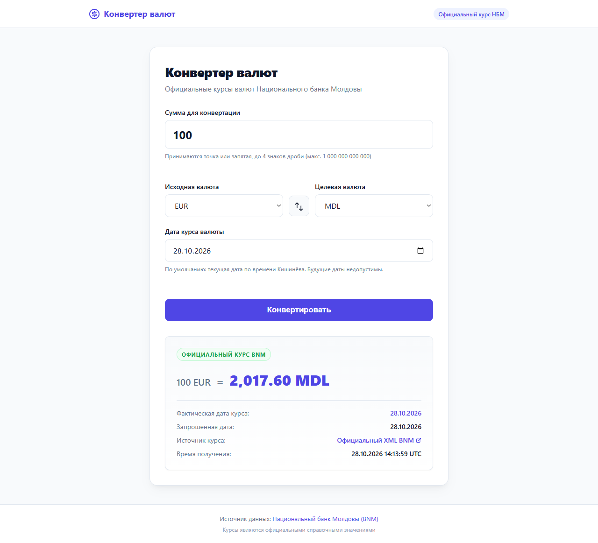

# BNM Currency Converter

**Lab 3 · C# / .NET 8 · Spec Kit → Copilot → Antigravity**

A Russian-language web app for converting **MDL, EUR, USD, RON, and GBP** using
official National Bank of Moldova rates. Select a date, swap currencies, and
explicitly confirm the use of a saved rate if the source is temporarily unavailable.
UI labels mentioned in this documentation are described in English.



## Quick start

Requires **.NET SDK 8 or later** with .NET 8 support. Internet access is required
to fetch new rates; no API key, Node.js, or database is needed.

Open the repository folder in VS Code, then run these commands in PowerShell
from the folder containing `CurrencyConverter.sln`:

```powershell
dotnet restore
dotnet run --project .\src\CurrencyConverter.Web\CurrencyConverter.Web.csproj --urls http://localhost:5080
```

Open **http://localhost:5080**. Stop the server with `Ctrl+C`.

## Features

| Feature | Behavior |
| --- | --- |
| Amount entry | Dot or comma; 0.0001 to 1,000,000,000,000; up to four decimal places |
| Validation | Client and server checks; invalid input prevents conversion |
| Date selection | Defaults to today in Chisinau; future dates are rejected |
| Historical rates | Searches for a publication within the previous 31 days; shows the actual date |
| Formula | `amount × (ValueSource / NominalSource) / (ValueTarget / NominalTarget)` |
| Precision | `decimal`; final result rounded to two places, with ties away from zero (`AwayFromZero`) |
| Same currency | Exact original amount with up to four places; no rate request |
| Cache | JSON file persists across restarts; atomic writes |
| Offline | A suitable cached rate is offered with its date and used only after explicit confirmation |
| Historical requests | A cached rate newer than the selected date cannot be used |
| Interface | Responsive layout, keyboard navigation, loading states, and errors |

Source: [official BNM XML](https://www.bnm.md/en/official_exchange_rates?get_xml=1&date=28.10.2026).
Official rates are for reference. Rates are fetched over the network, not embedded in the application code.

## Validation

From the repository root:

```powershell
dotnet build CurrencyConverter.sln
dotnet test
```

**Verified result:** 162 tests passed, 0 failures, 0 skips.
Unit tests use fixtures and fake HTTP handlers and run without BNM or internet access.
Opera GX scenarios, mobile layout checks, and actual screenshots are recorded in the
[interface validation report](docs/BROWSER_VALIDATION.md).

## Cache location

```text
src/CurrencyConverter.Web/App_Data/rates_cache.json
```

The file is created after a rate is fetched successfully. `App_Data` is excluded
from Git. Restarting the application does not delete it. Change the path using
`Cache:FilePath` in `appsettings.json` or the `Cache__FilePath` environment variable.
A corrupt cache is rejected. Write failures produce a warning while preserving
the successfully calculated result.

## Project structure

```text
CurrencyConverter.sln
src/
  CurrencyConverter.Core/            # models, validation, calculations
  CurrencyConverter.Infrastructure/  # BNM XML, JSON cache, Chisinau time
  CurrencyConverter.Web/             # Razor Pages, local CSS/JS
tests/
  CurrencyConverter.Tests/           # xUnit, fixtures, test doubles
specs/001-currency-converter/         # spec, plan, tasks, contracts
docs/                               # requirements, process, browser checks
REPORT.md                           # AI use, errors, and fixes
```

## Lab workflow

| Stage | Tool and result | Pull request |
| --- | --- | --- |
| Specifications | Spec Kit 1.2.4 + Copilot in VS Code: constitution, specification, plan, tasks, and analysis | [#1](https://github.com/sam4ch/bnm-currency-converter-web/pull/1) |
| Implementation | Antigravity CLI 1.4.9, **gemini-3.8-flash-high**: Core, Infrastructure, and Razor Pages | [#2](https://github.com/sam4ch/bnm-currency-converter-web/pull/2) |
| Testing | Antigravity: initial xUnit suite; Codex assistant: additional regression tests, review fixes, and validation runs | [#3](https://github.com/sam4ch/bnm-currency-converter-web/pull/3) |

Work uses separate `specs/currency-converter`, `feature/currency-converter`,
and `tests/currency-converter` branches, with PRs merged into `main`.
History reflects the actual sequence; specification documents preceded code.
The exact Copilot model selected in Auto mode was not established, as noted in the report.
Antigravity exhausted its quota after creating the initial test suite;
final fixes were completed in the Codex chat and attributed separately in the report.

## Documentation

- [Lab report: models, errors, fixes, and results](REPORT.md)
- [Original PDF requirements](docs/ASSIGNMENT_REQUIREMENTS.md)
- [Specification](specs/001-currency-converter/spec.md) · [Plan](specs/001-currency-converter/plan.md) · [Tasks](specs/001-currency-converter/tasks.md)
- [Project constitution](.specify/memory/constitution.md)
- [Data model](specs/001-currency-converter/data-model.md) · [Contracts](specs/001-currency-converter/contracts)
- [Browser validation and screenshots](docs/BROWSER_VALIDATION.md)
- [Test results](docs/TEST_RESULTS.md) · [Antigravity prompts used](docs/prompts)
- [UI checklist](specs/001-currency-converter/checklists/manual-browser-checklist.md)
