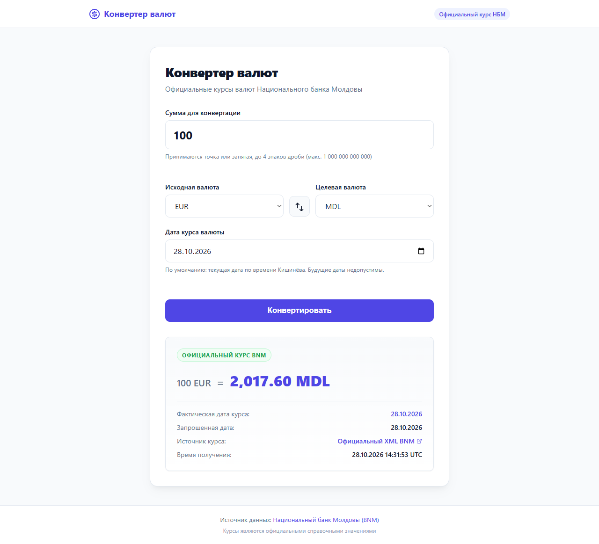
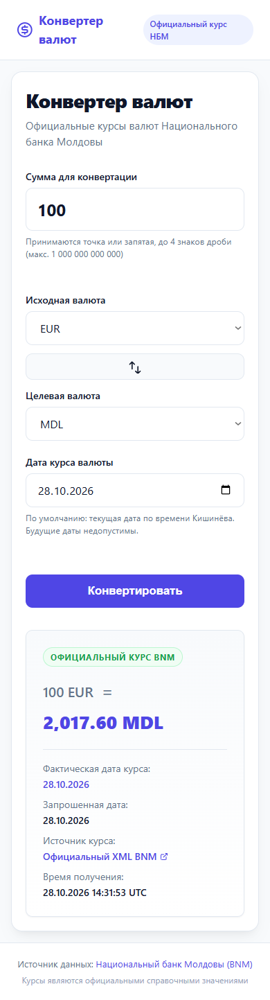

# Проверка браузерного интерфейса — 28.10.2026

Проверено ассистентом через Playwright в установленной Opera GX 138.0.6044.45,
с отдельным временным профилем. Это интеграционные браузерные проверки и
визуальный просмотр скриншотов, отдельно от xUnit. Пользовательская приёмка
на физическом телефоне не выполнялась. Edge отклонил запуск автоматизации
политикой администратора; политика не менялась.

Команда сборки: `dotnet build CurrencyConverter.sln --no-restore` — успешно,
0 предупреждений, 0 ошибок. Приложение реально запускалось на локальном HTTP.

| Сценарий | Результат |
| --- | --- |
| Пустая сумма, буквы, ноль, минус, экспонента, лишняя дробь/предел, `+1`, `.5`, `1.` | Кнопка заблокирована |
| Точка/запятая, 0.0001 и верхняя граница суммы | Корректный ввод разрешён |
| Будущая дата | Кнопка заблокирована |
| Обмен валют, полный порядок Tab: сумма, исходная валюта, обмен, целевая валюта, дата, кнопка | Работают |
| EUR → EUR, 123.4567 | Точное значение, «Курс не требуется», без метаданных курса |
| Отправка формы | Кнопка заблокирована, прежний результат скрыт |
| Реальный BNM, 100 EUR → MDL, 28.10.2026 | 2017.60 MDL; показаны фактическая/выбранная даты, ссылка и время |
| Обход JavaScript, отправка `abc` напрямую | Сервер отвергает ввод, результата нет |
| Перезапуск процесса с тем же JSON, источник недоступен | Сначала предложение кэша без результата; после явного подтверждения 2017.60 MDL |
| Дата 27.10.2026 при кэше от 28.10.2026 | Более новый кэш не предложен |
| Недоступный источник без файла кэша | Понятная ошибка, фиктивного результата нет |
| USD → USD, 10,1234 без сети и без кэша | Точная сумма сохраняется |
| Ширины 1280 и 390 px | Скриншоты просмотрены, горизонтального переполнения нет |
| JavaScript pageerror | Ошибок нет |

Проверка offline использует конфигурацию только собственного тестового процесса
(`Bnm__BaseUrl=http://127.0.0.1:9/?date=`), системная сеть не отключалась.
Для кэша использованы отдельные тестовые файлы в игнорируемой `.tools/`.
Полные локальные протоколы: `.tools/browser-qa/1793197898520/results.json`.

Найденный реальный дефект: статическое поле `CurrencyCode.Mdl` создавалось
раньше `SupportedCodes`, что приводило к `TypeInitializationException` при
первой конвертации. Antigravity исправил порядок; повторный прогон прошёл.
Дополнительно исправлены округление одинаковых валют, проверка будущей даты
в JavaScript и скрытие старого результата во время запроса.

Дополнительный итоговый прогон: **10/10 сценариев**. Проверен полный порядок клавиатурного фокуса, повтор без согласия не применяет кэш. Восстановление источника проверено на локальном HTTP-источнике с фиксированным XML: сначала 503, затем 200 в той же форме; ошибка исчезает, результат верен. Это контролируемый тест восстановления, отдельно от запроса к реальному BNM.
